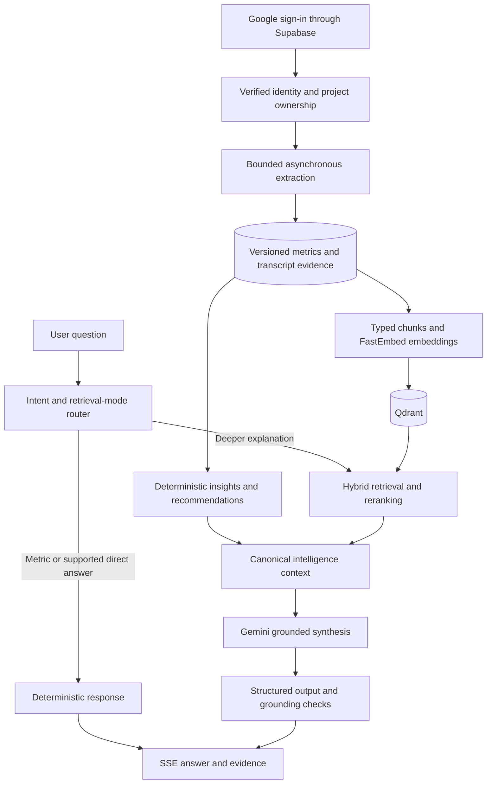
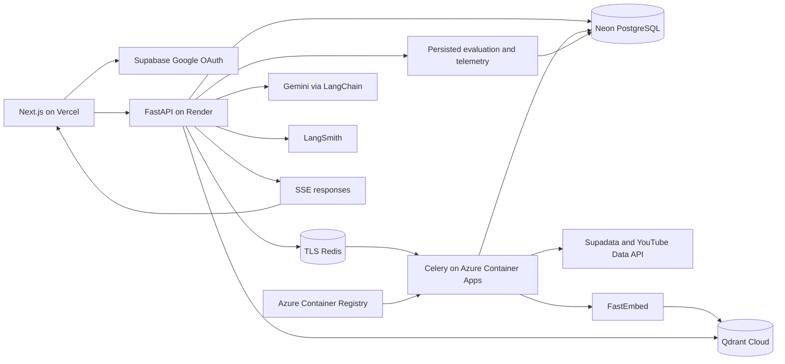
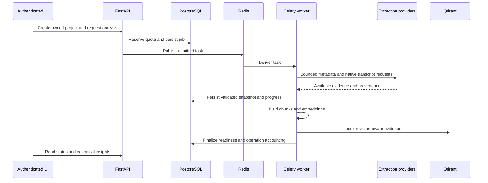
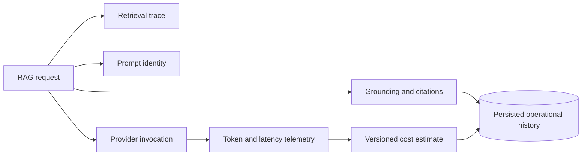

# CreatorLens AI

[](https://github.com/DiloJan-26/CreatorLens-AI/actions/workflows/backend-ci.yml)
[](https://github.com/DiloJan-26/CreatorLens-AI/actions/workflows/frontend-ci.yml)
[](https://github.com/DiloJan-26/CreatorLens-AI/actions/workflows/docker-build.yml)

### Evidence-grounded creator intelligence with hybrid RAG, explainable analytics and LLMOps

CreatorLens AI is an authenticated content-intelligence platform that compares two YouTube videos using public metrics and transcript evidence. It combines **Retrieval-Augmented Generation (RAG)** with **deterministic scoring and recommendations**, giving creators traceable findings and a cited AI Assistant for deeper analysis.

> Built with Python, FastAPI, LangChain, Gemini, FastEmbed, Qdrant, PostgreSQL and Next.js; deployed across Render, Azure Container Apps and Vercel.

[**Open CreatorLens AI**](https://creator-lens-ai.vercel.app/)

---

## Executive summary

CreatorLens AI connects the full AI application lifecycle: evidence ingestion, validation, embedding, retrieval, generation, evaluation and observability.

A Celery worker extracts metadata and native captions, validates language and timestamps, persists versioned evidence, and indexes typed chunks in Qdrant. The deterministic engine calculates independent performance signals and produces evidence-triggered recommendations. Both the Insights page and the Assistant consume these same results.

The RAG pipeline routes factual questions directly to structured data and uses hybrid retrieval for deeper explanations. Gemini generates schema-constrained answers through LangChain; backend validation checks citations, numerical claims and recommendation identity before SSE delivery. Google OAuth through Supabase, project ownership, durable quotas and provider admission govern access and execution.

## Project status

**Implemented:** authenticated creator workspace, asynchronous analysis, deterministic insights, streaming RAG Assistant, evaluation and LLM observability.

| Delivery area | Implementation |
| --- | --- |
| Product | Google sign-in, private projects, comparison, insights, evidence and chat |
| Intelligence | Independent metrics, opening observations and prioritized experiments |
| RAG | Five query modes, hybrid retrieval, deterministic reranking and grounded generation |
| Backend | FastAPI services, PostgreSQL repositories, durable jobs and usage accounting |
| Quality | Unit/integration suites, versioned offline evaluation and PostgreSQL migration checks |
| Cloud delivery | Docker, GitHub Actions, Render API, Azure worker and Vercel frontend |

Recorded validation results and release-verification boundaries are listed under [Validation evidence](#validation-evidence).

## Engineering highlights

| Capability | Implementation signal |
| --- | --- |
| Evidence-grounded RAG | Metadata, description, opening and transcript chunks with stable source identities and revision-aware citations |
| Hybrid retrieval | FastEmbed/Qdrant similarity combined with lexical overlap, source relevance and two-video balancing in the [reranker](backend/app/rag/reranker.py) |
| Structured LLM generation | Versioned YAML prompts and [Pydantic answer schemas](backend/app/llm/structured_outputs.py) for metric, comparison and recommendation responses |
| Grounding and safety | [Claim validation](backend/app/llm/assistant_grounding.py) against canonical values, citation ownership and recommendation targets; retrieved text treated as untrusted data |
| Explainable decision systems | [Deterministic intelligence](backend/app/insights/observed_intelligence.py) with independent eligibility, rational tie arithmetic and evidence-bound recommendation rules |
| Authentication and authorization | Supabase Google OAuth, [ES256 JWT verification](backend/app/core/identity.py), trusted issuer/audience checks and project-level ownership |
| Distributed execution | Celery jobs, PostgreSQL [dispatch outbox](backend/app/workers/dispatch_outbox.py), stable task identities and idempotent provider admission |
| Evaluation engineering | RAGAS retrieval metrics, DeepEval test cases, deterministic rubrics and separate false-accept/false-reject regressions |
| LLMOps | LangSmith traces, model/prompt attribution, token accounting and [effective-date cost estimation](backend/app/llm/cost_estimation.py) |
| Cost-aware processing | Cached extraction, reusable embeddings, bounded provider requests and durable quota/budget reservations |

## Product capabilities

- Compare observed reach, like rate, comment rate and current-audience efficiency independently.
- Review opening and description observations with source excerpts and evidence revisions.
- Get prioritized, testable recommendations tied to the correct video.
- Ask metric, explanation, transcript and improvement questions through cited streaming chat.
- Manage private analyses and inspect account usage through an authenticated workspace.
- Inspect evaluation and operational telemetry through authorized engineering views.

| Source | Current role | Boundary |
| --- | --- | --- |
| Public YouTube videos | Active bounded extraction using Supadata native transcripts and metadata | Videos up to the configured duration limit; missing fields remain explicit |
| YouTube Data API v3 | Optional enrichment of missing public statistics, publication date and subscriber count | Requires a configured API key, quota and provider admission |
| Instagram/Facebook and older extraction adapters | Historical compatibility in stored data and source code | New production extraction is not enabled by their presence |

## Scope Justification

### What problem does CreatorLens AI solve?

Creators can see views and likes, but deciding what to change requires connecting those numbers to the content itself. Generic AI feedback can sound convincing while mixing up videos, overlooking missing data or inventing explanations.

CreatorLens AI turns public evidence into an inspectable analysis:

```text
Confirmed metrics + validated transcripts and descriptions
                           |
          Independent comparisons and supported observations
                           |
          Prioritized experiments + cited RAG explanations
```

The result distinguishes observed performance from proposed creative changes. Every finding retains its supporting value or excerpt, and every recommendation identifies the video it concerns.

### Who needs it?

| User | Practical outcome |
| --- | --- |
| Creator | Compare two videos and choose a supported experiment for the next version |
| Content strategist | Review reach, response and messaging as separate dimensions |

### Real-world use cases

1. Compare two explanations of the same topic using public response signals and opening evidence.
2. Review whether the subject and learning takeaway appear early in an educational video.
3. Test a more specific introduction or description without claiming a guaranteed performance uplift.
4. Demonstrate grounded RAG with deterministic bypass, source attribution and observable model execution.

### Why compare two videos instead of scoring only one?

Pairwise review gives a useful reference while keeping the dimensions separate. One video can lead in lifetime views and another in like rate. The two-slot design also makes retrieval balance, content identity and recommendation attribution testable.

The comparison is observational: different publication dates, audiences and collection times prevent causal conclusions.

### What makes the scope distinctive?

| Engineering choice | Why it matters |
| --- | --- |
| Shared intelligence contract | The UI and Assistant use the same calculations, leaders and recommendation targets |
| Query-specific execution | Direct factual answers avoid unnecessary retrieval and model calls |
| Independent metric eligibility | Missing comments or subscriber counts do not suppress a valid Reach or Like Rate result |
| Source-aware retrieval | Evidence selection considers the question, source type and both content identities |
| Versioned evidence and policies | Stored findings can be traced to their inputs and reproduced |
| Quality and operational telemetry | Retrieval behavior, grounding failures, token usage and estimated cost are inspectable |

### Scope boundaries

The active extraction workflow supports bounded public YouTube videos. Public counts describe observed activity, not retention, audience sentiment, revenue or causal effects. Opening rules identify textual patterns rather than measure overall creativity. The current dictionary policy supports declared English evidence; multilingual generation quality is not claimed from those rules.

## CreatorLens AI Logic



### What is deterministic?

Metric normalization, score calculation, comparison eligibility, tie rules, textual observations, recommendation triggers and priorities all execute without Gemini. They are exposed through `summary.intelligence` under `observed-intelligence-1.0.0` and `opening-messaging-1.0.0`.

Identical evidence and policy inputs produce identical results. Historical scoring and semantic-analysis contracts remain compatibility data; they do not silently determine current findings.

### How are the creator scores calculated?

Let **V** be confirmed views, **L** likes, **C** comments and **S** current subscribers.

| Signal | Equation | Required inputs |
| --- | --- | --- |
| Reach | `V` | Confirmed view count |
| Like rate (%) | `100 * L / V` | Known likes and `V > 0` |
| Comment rate (%) | `100 * C / V` | Known comments and `V > 0` |
| Combined interaction rate (%) | `100 * (L + C) / V` | Both interaction fields and `V > 0`; contextual only |
| Audience efficiency | `V / S` | Known views and `S > 0` |

The backend also exposes three secondary scores on a 0-10 scale:

```text
reach_score              = min(10, 10 * ln(1 + V) / ln(10,000,001))
like_response_score      = min(10, 2 * like_rate_percent)
public_performance_score = (reach_score + like_response_score) / 2
```

The logarithmic reach transform compresses large count differences, reaching its cap at ten million views. Like response scales the observed percentage to a cap at 5%. It requires at least 1,000 views and consistent counts (`L <= V`). Public performance averages the two only when both are eligible. These anchors are documented heuristics, not population-calibrated predictions.

Missing inputs remain null; confirmed zero remains zero. There is no universal overall score and no numerical creativity score in the current policy.

### How is the comparison winner selected?

| Dimension | Decision rule |
| --- | --- |
| Reach | Higher confirmed views; exact equality is a tie |
| Like rate | Both videos need at least 1,000 views and valid likes; differences within 0.10 percentage points are tied |
| Comment rate | Descriptive values and difference; no winner policy |
| Audience efficiency | Higher views per current subscriber when both inputs are eligible; exact equality is a tie |
| Opening and messaging | Individual supported observations; no overall creative winner |

Rate-tie comparisons use rational arithmetic to avoid floating-point boundary errors. The current comparison policy requires two distinct, owned YouTube content identities. The sample threshold and tolerance are safeguards, not statistical significance tests.

For example, 485 likes on 34,021 views gives a **1.43% like rate**. That result remains calculable when the comment count is missing.

### What is the specialized retrieval technique?

Candidates are reranked using:

```text
retrieval_score = 0.55 * semantic_similarity
                + 0.25 * keyword_overlap
                + 0.10 * source_type_boost
                + 0.10 * slot_balance_bonus
```

- **Semantic similarity:** FastEmbed vectors retrieve passages with related meaning from Qdrant.
- **Keyword overlap:** matched meaningful query terms divided by total meaningful query terms preserves exact subject relevance.
- **Source-type boost:** favors the evidence the question requires, such as metadata for metrics or opening speech for hook review.
- **Slot-balance bonus:** favors an unrepresented video when assembling a comparative context.

The reranker selects a bounded evidence set using these fixed weights. It runs without an additional model or paid reranking call.

### Can scores or answers change every time?

| Output | Reproducibility |
| --- | --- |
| Metrics, scores, decisions and recommendations | Stable for the same evidence, selected objective and policy |
| Retrieval | Depends on query, index state, embedding model and retrieval policy |
| Gemini wording | May vary; canonical facts and targets remain constrained |
| Refreshed analysis | Can change when source snapshots or policy versions change |

## System architecture



### Deployment topology

| Responsibility | Runtime |
| --- | --- |
| Frontend and OAuth callback | Next.js on Vercel |
| Authorized API and SSE | FastAPI on Render |
| Durable application state | Neon PostgreSQL |
| Broker, result backend and shared request limits | TLS Redis shared by API and worker |
| Extraction and indexing | No-ingress Celery worker on Azure Container Apps |
| Worker image and diagnostics | Azure Container Registry and Log Analytics |
| Retrieval and tracing | Qdrant Cloud and LangSmith |

One Dockerfile supports separate web and worker roles. Web startup runs Alembic before Uvicorn; worker startup runs Celery. Matching source revisions and shared configuration keep both services compatible.

## Evidence ingestion pipeline



### Extraction is deliberately layered

Supadata supplies metadata and native transcript evidence. Optional YouTube Data API enrichment fills supported gaps using bounded `videos` and `channels` requests. Count groups are updated coherently rather than silently combining incompatible snapshots; previous values and field provenance remain inspectable.

Extraction artifacts and embeddings are cached. Missing, partial or invalid captions remain explicit, with language and timestamp validation before textual analysis. The active path does not automatically fall back to media downloading, generated transcription, Apify or Deepgram.

## Retrieval and RAG design

### Typed evidence index

| Source type | Retrieval purpose |
| --- | --- |
| Metadata | Metrics, title, creator, duration, publication context and provenance |
| Description | Creator-authored framing and topic context |
| Hook | Eligible opening-window transcript evidence |
| Transcript | Broader explanation and topic evidence |

Chunks carry project/content identity, stable slot, source type, evidence revision and timestamps where available. Retrieval and citation validation preserve those boundaries.

### Query-aware retrieval

The existing router retains five modes:

| Mode | Strategy |
| --- | --- |
| `metric_direct` | Read authoritative structured values without generation |
| `hook_focused` | Prioritize eligible opening evidence |
| `balanced_compare` | Balance retrieved evidence across both videos |
| `transcript_deep` | Retrieve relevant narrative passages |
| `strategy_recommendation` | Ground explanations in supported recommendation objects |

`balanced_compare` is a retrieval mode, not a universal winner formula. Explicit question intent can override the selected UI dimension. The context adapter checks evidence consistency before supplying canonical decisions and recommendation targets.

### Structured generation boundary

The backend defines the answer contract before invoking Gemini. Pydantic models distinguish three response types:

| Answer type | Validated content |
| --- | --- |
| Metric | Named values, content slot, confirmed/unavailable status and source citation |
| Comparison | Objective, canonical decision, supporting reasons, evidence and limitations |
| Recommendation | Authoritative recommendation ID, target, priority, experiment and supporting evidence |

Post-generation checks bind claims to current project/content identities and evidence revisions. Numerical assertions and winner labels must match canonical results; generated recommendations cannot reassign targets or priority. Hypothetical drafts retain an explicit hypothesis status.

Transcripts and descriptions enter prompts as untrusted evidence. Malformed JSON, provider failures and rejected claims use safe fallback responses. Citation-label validation is one check within this boundary, not a substitute for semantic entailment.

The SSE response carries structured answers, readable text, citations and completion events. Persisted conversation history reuses these contracts. Compatibility confidence fields are not displayed as calibrated probabilities.

## Deterministic creator intelligence

The textual rubric normalizes terms and uses word boundaries. It reviews an eligible first-eight-second opening, or an explicitly labeled first-40-word fallback without invented timing.

| Observation | Evidence-triggered experiment |
| --- | --- |
| Configured generic greeting at the start | Test the topic before the greeting/background |
| Title topic terms not detected in sufficiently complete opening evidence | Test a first sentence naming the subject |
| Configured learning-takeaway phrase not detected | For an explanation, test one sentence stating what the viewer can learn |
| Title topic terms not detected in the first 600 description characters | Test a more specific first description sentence |

Topic matching requires `min(2, number_of_title_anchor_terms)` normalized term overlaps. Absence of a pattern is a bounded lexical observation, not proof of weak messaging. Missing or stale evidence cannot create an absence-based recommendation.

Recommendation priority is reproducible:

```text
priority = evidence_support + objective_relevance + actionability
           each contribution is bounded from 0 to 2

High: >= 5     Medium: >= 3     Low: < 3
```

Complete evidence contributes 2; a supported local positive observation contributes 1. Relevance contributes 2 for structure review or applicable Reach opening/description experiments, otherwise 1. Current actionable templates contribute 2. Recommendations are deduplicated by video and intervention, ordered stably, and limited to three with representation for both targets where supported.

Each recommendation retains its ID, target content, trigger, evidence, revision, priority breakdown, experiment and limitation. Losing on a metric never independently triggers a creative defect.

## Evaluation and quality engineering

Evaluation covers retrieval, deterministic decisions, recommendation grounding and Assistant behavior using versioned datasets and offline fixtures.

| Evaluation component | What it measures |
| --- | --- |
| RAGAS | Non-LLM context precision and recall against reference contexts |
| DeepEval | `LLMTestCase` construction integrated with deterministic project rubrics |
| Grounding regressions | Incorrect counts/winners, cross-content citations, unsupported causal claims and forged priorities |
| False-rejection checks | Supported paraphrases and valid answers that should remain accepted |
| Integration contracts | Evidence freshness, ownership, recommendation identity, deterministic bypass and SSE behavior |

| Dataset | Recorded offline result |
| --- | --- |
| `creatorlens_ci_smoke_v1` | 5/5 passed |
| `creatorlens_core_v1` | 20/20 passed |
| `creatorlens_intelligence_ci_v2` | 23/23 passed |
| `creatorlens_intelligence_v2` | 119 passed, 0 failed, 14 skipped; 96/96 critical contracts passed |

Reports preserve dataset/evaluator versions, failures and skips. Lexical faithfulness/relevance are labeled as proxies; mocked responses and unreviewed semantic references are not presented as live model accuracy. Historical policies remain reproducible, while current intelligence and enrichment have dedicated unit/API regressions.

## LLMOps and observability



Recorded metadata includes provider/model identity, prompt version, token categories, retrieval/generation latency, cache behavior, source balance, correlation identifiers and failures. Deterministic answers are not counted as model invocations or given artificial token usage.

Pricing is Decimal-safe and selected by model, tier and inference date. Cached input and thinking tokens are accounted for explicitly; unknown or partial costs remain labeled. Historical estimates are preserved, and estimated charges are distinct from provider invoices or hard spending caps.

## Persistence model

PostgreSQL is the system of record for:

```text
users, project ownership and account entitlements
analysis reservations, provider operations and dispatch outbox
content metadata, transcript segments and evidence revisions
ingestion jobs, retrieval runs and indexed-chunk identities
chat sessions, messages and structured answers
evaluation datasets, runs and case results
LLM runs, token usage and cost events
```

SQLAlchemy repositories separate database access from HTTP and application logic; Alembic versions schema evolution. Transactions, row locking and stable operation identities support durable admission and accounting. Changing the initial free allowance does not overwrite an existing user's grant history.

Content hashing and embedding compatibility metadata support artifact reuse while retaining project ownership and evidence provenance.

## Evidence integrity rules

- Unknown metrics remain unknown; confirmed zero is preserved.
- A missing field blocks only calculations that actually require it.
- Every cited source belongs to the correct project, content and evidence revision.
- Untimed evidence never receives fabricated timestamps.
- Pattern absence is not equivalent to poor creative quality.
- Public interactions do not establish sentiment, retention or causal effects.
- Insights and chat share canonical facts, identities and recommendation priorities.

## Technology stack

| Layer | Technologies |
| --- | --- |
| Languages | Python 3.11, TypeScript 5 |
| Frontend | Next.js 16, React 19, Tailwind CSS 4 |
| API and streaming | FastAPI, Pydantic, sse-starlette, HTTPX |
| Authentication | Supabase Auth, Google OAuth, PyJWT |
| Database and migrations | PostgreSQL, Neon, SQLAlchemy, Alembic, Psycopg |
| Background processing | Celery, Redis |
| LLM orchestration | LangChain, langchain-google-genai, Gemini Developer API |
| Embeddings | FastEmbed, BAAI/bge-small-en-v1.5 |
| Vector database | Qdrant Cloud, qdrant-client |
| Data providers | Supadata, YouTube Data API v3 |
| Evaluation and testing | RAGAS, DeepEval, Pytest, RapidFuzz |
| Prompt configuration | YAML, PyYAML |
| Observability | LangSmith, Azure Log Analytics |
| Containers and registry | Docker, Azure Container Registry |
| Cloud hosting | Render, Azure Container Apps, Vercel |
| CI and frontend validation | GitHub Actions, ESLint, TypeScript |

### Redis deployment note

The API and worker share a TLS Redis connection through `REDIS_URL`. Celery uses a direct Redis connection, not a REST endpoint. Broker polling and request-limit accounting consume commands even at low application traffic, so provider command quotas are an operational capacity constraint.

## Repository map

```text
CreatorLens-AI/
|-- backend/
|   |-- app/api/                  # Authorized HTTP and SSE routes
|   |-- app/core/                 # Configuration, JWT, ownership and admission
|   |-- app/db/                   # Models, repositories and sessions
|   |-- app/extraction/           # Bounded providers and metadata enrichment
|   |-- app/insights/             # Deterministic metrics and recommendations
|   |-- app/rag/                  # Context, chunking, retrieval and reranking
|   |-- app/llm/                  # Prompts, schemas, grounding and pricing
|   |-- app/evaluations/          # Datasets, fixtures and offline runners
|   |-- app/services/            # Application, accounting and chat services
|   |-- app/workers/             # Celery tasks and durable dispatch
|   |-- alembic/                 # Database migrations
|   `-- tests/                   # Unit and integration regressions
|-- frontend/
|   |-- src/app/                 # Landing, OAuth and workspace routes
|   |-- src/components/          # Comparison, insights, chat and dashboards
|   |-- src/lib/                 # Auth, API and SSE clients
|   `-- src/types/               # Frontend contracts
`-- .github/workflows/           # Quality gates and worker-image builds
```

## Validation evidence

Latest recorded local checks include **897 unit tests passed**, **93 integration tests passed with 3 skipped**, legacy and V2 offline evaluation, Python compilation, frontend UI/auth contract checks, ESLint, TypeScript and a production build using synthetic HTTPS API configuration.

The integration skips require disposable PostgreSQL execution in CI. These are recorded engineering checks, not a claim of complete browser, provider or production acceptance.

Representative commands, using the existing backend virtual environment:

```powershell
# Backend: run from backend/
.\.venv\Scripts\python.exe -m pytest tests/unit -q
.\.venv\Scripts\python.exe -m pytest tests/integration -q
.\.venv\Scripts\python.exe -m compileall app tests
.\.venv\Scripts\python.exe -m app.evaluations.regression_runner --dataset creatorlens_ci_smoke_v1 --no-persist
.\.venv\Scripts\python.exe -m app.evaluations.offline_runner --dataset creatorlens_core_v1
.\.venv\Scripts\python.exe -m app.evaluations.offline_runner --dataset creatorlens_intelligence_v2 --strict

# Frontend: run from frontend/
npm ci
npm run test:auth
npm run test:ui
npm run lint
npx tsc --noEmit
npm run build
```

### CI checks

| Workflow | Scope |
| --- | --- |
| Backend CI | Compilation, unit/integration tests, disposable PostgreSQL migrations, legacy and V2 offline evaluation |
| Frontend CI | Auth/UI contracts, lint, TypeScript and production build with synthetic public configuration |
| Docker Build CI | Backend container build |
| Worker image workflow | Manually requested, commit-tagged image publication to Azure Container Registry |

Standard test/evaluation jobs use offline fixtures and do not require production credentials or paid inference. Worker-image publication is a separate authorized delivery workflow.

### Reliability status

Private API access requires verified identity and resource ownership. Durable account policies provide five lifetime analyses for new users, one concurrent analysis per user and three generative Assistant admissions per completed analysis. Stored results and deterministic answers remain available without new model generation.

Provider execution passes separate operation, reservation, pricing, budget and emergency-stop checks. Limits and credentials use validated configuration in [backend/.env.example](backend/.env.example) and [frontend/.env.example](frontend/.env.example). Backend secrets are never browser configuration.

Offline tests establish regression behavior; live OAuth, provider availability, browser workflows and cloud capacity require release-specific acceptance.

## Design principles

```text
Evidence before inference.
Independent signals before universal rankings.
Deterministic findings before generated explanations.
Structured contracts before prose.
Ownership and accounting before provider execution.
Measured limitations before unsupported accuracy claims.
```

## License

Proprietary source-available project for portfolio review and technical evaluation. See [LICENSE](LICENSE) for permissions and restrictions.
