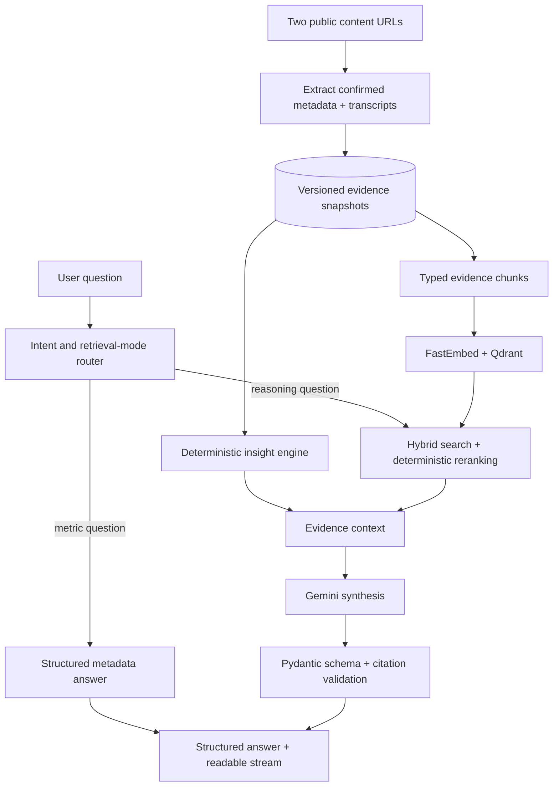
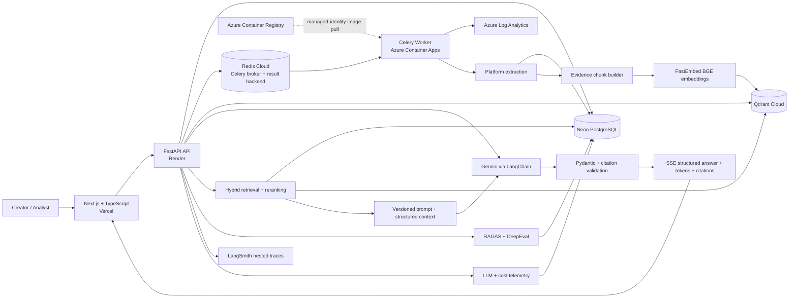
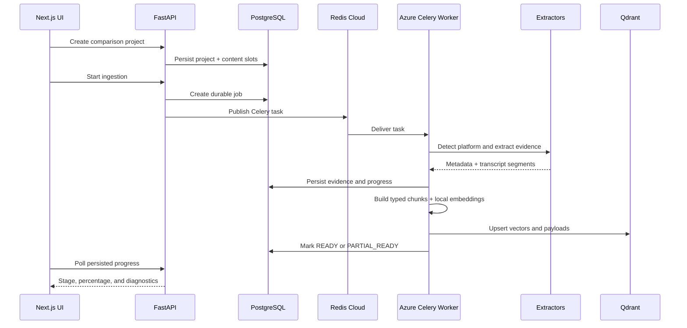
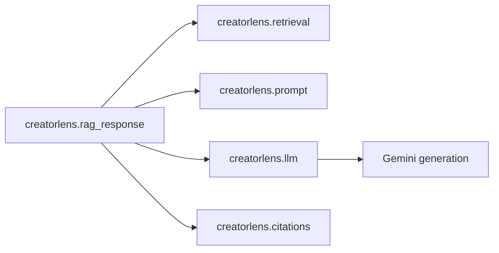

# CreatorLens AI

[](https://github.com/DiloJan-26/CreatorLens-AI/actions/workflows/backend-ci.yml)
[](https://github.com/DiloJan-26/CreatorLens-AI/actions/workflows/frontend-ci.yml)
[](https://github.com/DiloJan-26/CreatorLens-AI/actions/workflows/docker-build.yml)

### Evidence-grounded, multi-cloud RAG intelligence for short-form content

CreatorLens AI compares two public YouTube, Instagram, or Facebook videos and turns their confirmed metadata, transcripts, creative structure, and engagement signals into defensible creator insights. It combines deterministic analytics with hybrid retrieval and structured LLM reasoning so every factual conclusion remains traceable to source evidence.

> Built as a production-style AI engineering case study: asynchronous ingestion, vector retrieval, constrained generation, evaluation, LLM observability, and a cost-controlled multi-cloud deployment.

[**Open CreatorLens AI →**](https://creator-lens-ai.vercel.app/)

---

## Executive summary

Most content-analysis demos send a transcript to an LLM and display unverified prose. CreatorLens AI treats the problem as an evidence system.

The platform normalizes two public content URLs, runs extraction asynchronously, records confirmed metadata and timed transcript evidence, builds typed retrieval chunks, indexes them in Qdrant, and routes each question through the appropriate retrieval strategy. Metric questions bypass vector search when structured data can answer them directly; comparison questions balance evidence across both contents; hook questions prioritize early transcript segments. Gemini produces internally structured answers that are validated, citation-checked, and streamed to the UI.

The same workflow is observable end to end through persisted retrieval and LLM runs, LangSmith traces, token and latency telemetry, regression datasets, and a deployed evaluation dashboard.

## Project status

**The planned CreatorLens AI V2 implementation is complete and deployed.** Backend, frontend, ingestion workers, structured RAG, evaluation, LLM observability, and CI/CD reliability controls have completed local, GitHub-hosted, and deployed smoke acceptance.

| Delivery area | Accepted state |
| --- | --- |
| Product experience | Deployed analysis, evidence, structured chat, evaluation, and LLMOps views |
| Backend platform | FastAPI APIs, durable PostgreSQL state, hybrid retrieval, structured generation, and observability |
| Async ingestion | Redis-backed Celery processing on Azure Container Apps with persisted progress and graceful partial readiness |
| Quality engineering | 114 unit tests, eight integration tests, deterministic evaluation smoke suite, and migration validation |
| Delivery controls | Required backend, frontend, evaluation, and Docker checks enforced on production pull requests |
| Protection acceptance | Successful changes are admitted; intentional backend and frontend failures are confirmed to block merging |

## Engineering highlights

| Capability | Implementation signal |
| --- | --- |
| Evidence-grounded RAG | Typed metadata, description, hook, and transcript chunks with backend-owned citation labels |
| Retrieval intelligence | Query routing, semantic + keyword hybrid scoring, source boosts, deterministic reranking, and slot balancing |
| Structured generation | Pydantic answer contracts, versioned YAML prompts, citation validation, and defensive JSON fallback parsing |
| Deterministic reasoning | Confirmed metric comparisons and creator insight scores execute without depending on LLM inference |
| Asynchronous processing | Celery ingestion worker on Azure Container Apps with Redis Cloud as broker/result backend |
| Durable state | PostgreSQL repositories, Alembic migrations, persisted jobs, retrieval runs, evaluations, chats, and LLM telemetry |
| RAG evaluation | RAGAS + DeepEval contracts, deterministic rubrics, forbidden-claim checks, and curated regression fixtures |
| LLMOps | Nested LangSmith traces plus model, prompt, token, latency, source-balance, fallback, and error telemetry |
| Cost-aware architecture | Local FastEmbed embeddings, content-hash reuse, cached extraction artifacts, bounded evaluation, and explicit unavailable-cost handling |
| Multi-cloud operations | Vercel, Render, Neon, Redis Cloud, Qdrant Cloud, Azure Container Apps, ACR, and Log Analytics |

## Product capabilities

- Compare any supported Content 1 / Content 2 platform combination.
- Extract confirmed public metrics without estimating unavailable values.
- Recover transcripts through a layered caption and speech-to-text pipeline.
- Score public performance, creator-size efficiency, creative structure, and evidence confidence.
- Compare hooks using timestamped evidence from the opening seconds.
- Ask metric, comparison, transcript, or recommendation questions through streaming chat.
- Inspect evidence chunks, retrieval behavior, citations, and structured answers.
- Review persisted evaluation runs and case-level quality gates.
- Inspect LLM tokens, retrieval/generation latency, prompt versions, source balance, and trace coverage.

Supported sources:

| Platform | Inputs | Evidence strategy |
| --- | --- | --- |
| YouTube | Shorts, watch URLs, and `youtu.be` URLs | Public metadata, captions, Supadata/Apify fallback, and audio transcription when required |
| Instagram | Reels, posts, and public video URLs | Public extraction with Deepgram transcription when public audio is available |
| Facebook | Reels, watch URLs, and public video posts | Public extraction with Deepgram transcription when public audio is available |

## Scope Justification

### What problem does CreatorLens AI solve?

Creators and marketing teams can usually see **what** happened—views, likes, comments, or watch-page metadata—but those numbers do not explain **why one creative worked better, which evidence supports that conclusion, or what should change next**. Generic LLM analysis has the opposite problem: it can produce fluent recommendations, but without a controlled evidence layer it may invent metrics, overlook missing data, or favor whichever transcript fragment happens to appear first.

CreatorLens AI closes that gap by turning two public content items into a comparable evidence model:

```text
confirmed performance signals
        +
creative evidence from hooks, captions, CTAs, and transcripts
        +
creator-size and metadata-confidence context
        ↓
traceable comparison, explanation, and next-action recommendations
```

It is not another social-media dashboard and it is not an unconstrained “ask an LLM” wrapper. It is a decision-support system for explaining relative creative performance from the public evidence that is actually available.

### Who needs it?

| User | Practical need | CreatorLens AI outcome |
| --- | --- | --- |
| Individual creator | Understand why one post outperformed another | Hook, structure, CTA, audience, and performance comparison |
| Social media strategist | Review multiple creative directions consistently | Repeatable evidence and score framework instead of subjective feedback alone |
| Brand or growth team | Compare campaign creatives across channels | Normalized cross-platform evidence with provenance and limitations |
| Agency analyst | Explain recommendations to a client | Citation-backed findings and inspectable source material |
| Content lead | Turn a successful post into a learning reference | Transferable patterns and prioritized improvements for the weaker content |
| AI/ML reviewer | Inspect whether an AI answer is grounded | Retrieval traces, structured output, evaluation results, and explicit missing evidence |

### Real-world use cases

1. **Creative postmortem:** compare a strong and weak post after publication to identify differences in hook clarity, positioning, CTA, and confirmed performance.
2. **Cross-platform adaptation:** compare how related ideas performed on YouTube, Instagram, or Facebook before adapting the next version.
3. **Content iteration:** use a proven Content 1 as the evidence-backed reference for improving Content 2.
4. **Competitive research:** compare public competitor content without requiring access to private analytics, while clearly respecting the limits of public data.
5. **Client reporting:** replace unsupported opinions with traceable claims, citations, confidence notes, and missing-data warnings.
6. **RAG quality demonstration:** show how retrieval, structured generation, evaluation, and observability work in a realistic AI product rather than a toy chatbot.

The product performs request-driven analysis and streams answers once evidence is ready. It is not a continuous social-listening or real-time platform firehose.

### Why compare two videos instead of scoring only one?

A single content score can describe one item, but it lacks a reference point. A score of `7/10` does not by itself reveal which creative difference matters or whether a recommendation is specific to that content. Pairwise comparison creates a practical counterfactual-style review: **what is present in the stronger example that is absent or weaker in the other?**

The two-slot design enables CreatorLens AI to:

- compare like-for-like evidence rather than return generic best practices;
- distinguish raw reach from creator-size-adjusted efficiency;
- identify hook, CTA, caption, and problem-solution differences;
- balance retrieval so both contents appear in the LLM context;
- produce a supported winner, tie, or `insufficient_evidence` result;
- generate recommendations for Content 2 using Content 1 as a concrete reference.

The deterministic scoring functions can technically evaluate one content item, and the system already degrades safely when only one item is available. The primary product workflow intentionally requires two URLs because comparative diagnosis—not isolated grading—is the differentiated use case. A future single-content mode could reuse the same scoring engine against historical, category, or creator-specific benchmarks, but no such benchmark dataset is claimed today.

### What makes the scope distinctive?

| Common approach | CreatorLens AI approach |
| --- | --- |
| Send raw transcript to an LLM | Build typed, timestamped, source-aware evidence first |
| Ask the model to score quality | Calculate core scores with versioned deterministic rules |
| Use vector similarity for every question | Route metric questions directly to structured metadata |
| Retrieve whichever chunks rank highest | Add keyword relevance, source boosts, and two-slot balance |
| Display plausible prose | Validate structured output and whitelist citations |
| Hide incomplete extraction | Preserve `Unavailable`, confidence notes, and limitations |
| Evaluate manually during demos | Run curated RAGAS/DeepEval regression cases and persist results |
| Treat tracing as an afterthought | Trace retrieval → prompt → LLM → citations and persist operational telemetry |

### Scope boundaries

- Public metrics are snapshots and may differ from private creator analytics or later platform values.
- Cross-platform metrics are not assumed to be perfectly equivalent; platform and source provenance remain visible.
- The system provides evidence-grounded diagnostic signals, not causal proof or guaranteed predictions of virality.
- Missing fields reduce confidence and are never converted into estimated values.
- Recommendations are decision support for a human creator or strategist, not autonomous publishing decisions.

## CreatorLens AI Logic

CreatorLens AI uses a **hybrid deterministic + retrieval + generative architecture**. The LLM is deliberately placed near the end of the pipeline, after evidence collection, scoring, and retrieval.



### What is deterministic?

The following behavior does **not** depend on an LLM:

- URL normalization, platform detection, extraction orchestration, and content hashing;
- engagement-rate calculation from confirmed values;
- hook pattern detection and hook classification;
- caption, CTA, audience, problem-solution, performance, efficiency, and confidence scores;
- overall Creator Insight Score;
- deterministic winner/tie selection for the Creator Insight Summary;
- query routing for direct metric questions;
- keyword-overlap scoring, source boosts, and slot-balance bonuses;
- citation-label construction and citation allow-list validation;
- missing-evidence and forbidden-claim evaluation rules.

For the same stored evidence and the same code version, these outputs are repeatable.

### How are the creator scores calculated?

All component scores are bounded from `0` to `10`.

| Score | Technique |
| --- | --- |
| Hook clarity | Inspects transcript segments beginning within the first eight seconds, then detects questions, statistics, problems, benefits, audience relevance, specificity, concise openings, and weak generic intros |
| Caption strength | Rule-based topic, audience, problem/benefit, CTA/question, and hashtag signals |
| CTA strength | Counts explicit action terms and question prompts, then applies bounded thresholds |
| Audience specificity | Detects named audiences, problems, topic clarity, relevant hashtags, and specific subjects |
| Problem-solution clarity | Combines hook classification with problem, solution, transformation, and benefit patterns |
| Creative structure | Weighted combination of the five creative signals |
| Public performance | Threshold bands for confirmed views, interactions, and engagement rate |
| Creator efficiency | Views and interactions normalized by confirmed follower/subscriber count |
| Metadata completeness | Availability ratio across transcript, metric, creator, hashtag, date, and duration fields; reported as evidence context rather than creative quality |
| Engagement confidence | Availability of confirmed views, interactions, and engagement rate—not creative quality |

Creative structure is calculated as:

```text
creative_structure_score =
    0.30 × hook_clarity
  + 0.25 × problem_solution_clarity
  + 0.20 × caption_strength
  + 0.15 × cta_strength
  + 0.10 × audience_specificity
```

The overall deterministic score is:

```text
overall_score =
    0.35 × public_performance_score
  + 0.30 × creator_efficiency_score
  + 0.25 × creative_structure_score
  + 0.10 × engagement_confidence
```

For non-Facebook content, confirmed engagement rate is calculated when possible as:

```text
engagement_rate = ((likes + comments) / views) × 100
```

Platform-specific interaction handling is used where reactions or shares are the available public signals. If the denominator or interaction evidence is unavailable, the rate remains unavailable.

### How is the comparison winner selected?

The deterministic comparison prioritizes the strongest mutually available evidence:

1. compare confirmed engagement rate when both contents have it;
2. otherwise compare confirmed views when both have views;
3. otherwise compare confirmed interactions when both have them;
4. otherwise report that the metric winner is unavailable.

Hook, creative-structure, and overall scores within one point are treated as a tie. Creator efficiency also has an explicit closeness threshold. This avoids presenting tiny score differences as meaningful victories.

### What is the specialized retrieval technique?

CreatorLens AI does not use plain vector search. The query router first chooses a mode, then applicable candidates are reranked with:

```text
final_score =
    0.55 × semantic_score
  + 0.25 × keyword_overlap_score
  + 0.10 × source_type_boost
  + 0.10 × slot_balance_bonus
```

- `semantic_score` captures meaning through FastEmbed vectors and Qdrant.
- `keyword_overlap_score` preserves exact terms that embeddings may blur.
- `source_type_boost` favors metadata, hook, or transcript evidence appropriate to the question.
- `slot_balance_bonus` prevents one content item from monopolizing a comparison.

This is why a metric question, hook question, and broad strategy question do not all receive the same retrieval treatment.

### What is the LLM used for?

Gemini is used for tasks where natural-language synthesis adds value:

- explain why supported differences may matter;
- summarize multi-source evidence into a readable comparison;
- generate prioritized recommendations grounded in retrieved evidence;
- answer deep transcript or strategy questions;
- produce schema-validated comparison and recommendation objects for the UI.

Direct metric answers are constructed deterministically from structured metadata. Gemini is **not** responsible for extracting public metrics, calculating the core scores, choosing retrieval weights, creating allowed citation labels, or filling missing evidence. Its output must conform to Pydantic schemas, its citation labels must match backend evidence, and invalid JSON falls back safely. The configured low temperature reduces unnecessary variation but does not make generative language perfectly deterministic.

### Can scores or answers change every time?

| Output | Stable for identical inputs? | When it can change |
| --- | --- | --- |
| Stored public metrics | Yes, for the stored snapshot | Re-ingestion after the platform updates its public counts or extraction source |
| Engagement and Creator Insight scores | Yes | Evidence snapshot, scoring code, thresholds, or data availability changes |
| Deterministic winner/tie | Yes | Comparable metrics or deterministic scores change |
| Retrieval ranking | Normally yes for the same query/index/model | Query, indexed evidence, embedding model, filters, or collection state changes |
| Direct metric answer | Yes; it bypasses the LLM | Underlying confirmed metadata changes |
| LLM comparison/recommendation wording | Not guaranteed to be identical | Model sampling, provider/model version, prompt version, or retrieved context changes |
| LLM confidence field | Model-generated but schema-bounded | Evidence context or model response changes; it is not the deterministic score |

Therefore, the numerical creator scores do **not** randomly change on each request. The generated explanation may be phrased differently, but it remains constrained by the same evidence, response schema, citation allow-list, and missing-evidence rules.

## System architecture



### Deployment topology

| Responsibility | Runtime |
| --- | --- |
| User experience | Next.js application on Vercel |
| Synchronous API and streaming | FastAPI container on Render |
| Durable relational state | Neon PostgreSQL |
| Background task transport | Direct Redis Cloud connection shared by API and worker |
| Long-running extraction/indexing | No-ingress Celery worker on Azure Container Apps Consumption |
| Private worker images | Azure Container Registry with managed identity and scoped `AcrPull` |
| Worker diagnostics | Azure Log Analytics |
| Vector evidence | Qdrant Cloud |
| Model tracing | LangSmith Developer workspace |

The Docker image is role-aware: `SERVICE_ROLE=web` runs migrations before Uvicorn, while `SERVICE_ROLE=worker` starts the Celery worker. This keeps the API and worker reproducible from one image while preserving separate runtime responsibilities.

## Evidence ingestion pipeline



### Extraction is deliberately layered

Public social platforms are inconsistent and cloud-hosted requests are frequently restricted. CreatorLens AI therefore treats transcript recovery as a fallback graph rather than a single API call:

```text
platform captions
    → Supadata or Apify transcript fallback where applicable
    → yt-dlp media/audio fallback
    → Deepgram multilingual transcription
    → explicit transcript-unavailable state
```

Transcript completeness is checked against known duration. A short partial transcript is not silently treated as complete, and a missing transcript produces a valid metadata-only `PARTIAL_READY` project rather than a failed or fabricated analysis.

## Retrieval and RAG design

### Typed evidence index

| Source type | Purpose |
| --- | --- |
| `metadata` | Confirmed metrics, creator identity, duration, upload date, availability, and provenance |
| `description` | Caption framing, calls to action, hashtags, and creator-authored context |
| `hook` | Opening transcript segment used for first-seconds analysis |
| `transcript` | Timed semantic evidence for deeper reasoning |

Every indexed chunk carries project isolation, content slot, platform, source type, timing, creator/title context, a stable content hash, and a backend-generated citation label.

### Query-aware retrieval

The router selects one of five retrieval modes:

```text
metric_direct
hook_focused
balanced_compare
transcript_deep
strategy_recommendation
```

Metric questions use structured PostgreSQL metadata and do not depend on vector similarity. Other modes retrieve Qdrant candidates and apply the deterministic scoring contract:

```text
final_score =
    0.55 × semantic_score
  + 0.25 × keyword_overlap_score
  + 0.10 × source_type_boost
  + 0.10 × slot_balance_bonus
```

Balanced comparison ensures both `content_1` and `content_2` contribute evidence instead of allowing one content item to dominate the context window.

### Structured generation boundary

Gemini never defines the response contract. The backend selects a versioned prompt and validates the model output against one of three Pydantic structures:

- metric answer
- comparison answer
- recommendation answer

A comparison result follows a predictable internal shape:

```json
{
  "answer_type": "comparison",
  "winner": "content_1 | content_2 | tie | insufficient_evidence",
  "confidence": 0.0,
  "key_reasons": [],
  "evidence": [],
  "limitations": [],
  "recommendations": []
}
```

Model-generated citation labels are accepted only when they match the backend evidence set. Invalid JSON is handled by a defensive parser and safe fallback response, while the SSE stream preserves a readable Markdown answer for compatibility.

## Deterministic creator intelligence

The Creator Insight Summary does not call the LLM and does not claim to predict virality. It produces explainable review signals from confirmed evidence:

| Signal | Inputs |
| --- | --- |
| Public performance | Views, interactions, and engagement rate |
| Creator efficiency | Performance relative to confirmed follower/subscriber count |
| Creative structure | Hook, CTA, audience specificity, caption, and problem-solution framing |
| Evidence confidence | Metric availability and extraction completeness |

```text
Overall Creator Insight Score
  = 35% public performance
  + 30% creator-size efficiency
  + 25% creative structure
  + 10% evidence confidence
```

Separating deterministic analytics from generative reasoning makes the platform easier to test, explain, and trust.

## Evaluation and quality engineering

CreatorLens AI includes a first-class RAG evaluation subsystem rather than treating quality as a manual demo check.

| Asset | Coverage |
| --- | --- |
| `creatorlens_core_v1` | 20 metric, comparison, and recommendation regression cases |
| `creatorlens_ci_smoke_v1` | Five deterministic cases designed for bounded CI execution |
| Stable project fixtures | Known metadata, transcript, source, and missing-evidence conditions |
| Rubric checks | Citation presence, both-slot comparison, forbidden claims, limitations, and missing-metric compliance |
| RAGAS | Non-LLM context precision and recall through a compatibility boundary |
| DeepEval | Test-case contracts and regression orchestration |

The deployed evaluation dashboard exposes persisted runs, aggregate quality signals, historical comparisons, and case-level rubric results. Lexical faithfulness/relevance signals are explicitly labeled as lexical metrics and are not misrepresented as paid LLM-judge scores.

The accepted v1.1 core regression run recorded **20/20 passing cases**, with citation presence and missing-evidence compliance enforced as quality gates.

## LLMOps and observability

Each RAG interaction creates an auditable operational record.



Tracked signals include:

- model, provider, prompt name, and prompt version
- input, output, and total tokens
- retrieval and LLM latency
- retrieved chunk count and source balance
- transcript provider and fallback usage
- cache hit/miss and embedding reuse when observable
- LangSmith trace ID, retrieval-run ID, session ID, and error code
- estimated cost when model pricing is configured; otherwise an explicit unavailable state

The LLMOps dashboard is read-only and never triggers model calls. It exposes recent runs, token mix, latency composition, trace coverage, retrieval balance, and reliability signals from persisted telemetry.

## Persistence model

PostgreSQL is the system of record for:

```text
projects and content items
metadata snapshots and metric sources
transcript segments and evidence chunks
ingestion jobs
chat sessions and messages
retrieval runs
evaluation datasets, runs, and case results
LLM runs and cost events
```

SQLAlchemy repositories keep persistence out of API routes, while Alembic provides repeatable schema evolution. URL normalization and content hashing allow reusable extraction artifacts and embedding-aware deduplication without weakening project-level isolation.

## Evidence integrity rules

- Missing views, likes, comments, followers, duration, or transcript evidence remain unavailable.
- The system does not estimate absent public metrics.
- Factual claims require backend-provided evidence and valid citation labels.
- Metadata availability affects confidence, not creative quality.
- Heuristic insight scores are review signals, not guaranteed performance predictions.
- Metric-source provenance and transcript-provider notes remain attached to the evidence.
- Partial extraction degrades gracefully to evidence-limited analysis.

## Technology stack

| Layer | Technology |
| --- | --- |
| Frontend | Next.js 16, React 19, TypeScript 5, Tailwind CSS 4 |
| API | Python 3.11, FastAPI, Pydantic, SSE |
| Persistence | PostgreSQL, SQLAlchemy, Alembic, Neon |
| Async processing | Celery, Redis Cloud, Azure Container Apps |
| Containers and registry | Multi-stage Docker, Azure Container Registry |
| Embeddings | FastEmbed with `BAAI/bge-small-en-v1.5` |
| Vector database | Qdrant Cloud |
| LLM orchestration | LangChain + Gemini |
| Structured output | Pydantic schemas + YAML prompt registry |
| Evaluation | RAGAS, DeepEval, deterministic rubric checks |
| Observability | LangSmith, persisted LLM/retrieval runs, Azure Log Analytics |
| Delivery | Vercel, Render, GitHub Actions CI, protected production promotion, and worker-image workflows |

### Redis deployment note

The initial queue design used Upstash. It was replaced after Celery polling exhausted the free command allowance. Dev-Staging now uses a direct Redis Cloud Essentials connection shared by Render and Azure.

The current provider-issued endpoint is non-TLS and is accepted only for the portfolio Dev-Staging environment. A production promotion requires a TLS-enabled Redis service and secret rotation. Connection values are platform secrets and are never committed or printed.

## Repository map

```text
CreatorLens-AI/
├── backend/
│   ├── app/api/                 # FastAPI routes
│   ├── app/db/models/           # SQLAlchemy persistence models
│   ├── app/db/repositories/     # Repository boundary
│   ├── app/evaluations/         # Datasets, fixtures, rubrics, runners
│   ├── app/extractors/          # YouTube, Instagram, Facebook
│   ├── app/insights/            # Deterministic creator scoring
│   ├── app/llm/                 # Prompts, schemas, tracing, citations
│   ├── app/rag/                 # Chunking, retrieval, reranking, chat
│   ├── app/services/            # Application and provider services
│   ├── app/workers/             # Celery jobs and runtime
│   ├── alembic/                 # Versioned schema migrations
│   └── tests/                   # Unit and integration coverage
├── frontend/
│   └── src/
│       ├── app/                 # Product routes
│       ├── components/          # Analysis, chat, evaluation, LLMOps UI
│       ├── lib/                 # API/SSE client
│       └── types/               # Frontend contracts
└── .github/workflows/           # CI quality gates and worker-image delivery
```

## Validation evidence

The latest accepted validation baseline includes:

- backend compile/import validation
- **114 backend unit tests**
- **8 backend integration tests**
- deterministic five-case and 20-case evaluation runs
- Alembic upgrade validation through migration head
- frontend ESLint, TypeScript, and optimized Next.js production build
- GitHub-hosted backend, frontend, evaluation-smoke, and Docker-image checks on `main`
- enforced production pull requests with confirmed backend and frontend failure rejection
- deployed ingestion acceptance across Render → Redis Cloud → Azure Container Apps → Neon/Qdrant
- deployed structured-chat, LangSmith trace, evaluation-dashboard, and LLMOps-dashboard acceptance
- final deployed application smoke acceptance after production promotion

Representative non-runtime checks:

```powershell
# Backend
cd backend
python -m compileall app tests
python -m pytest tests/unit -q
python -m pytest tests/integration -q
python -m app.evaluations.regression_runner --dataset creatorlens_ci_smoke_v1 --no-persist
python -m alembic -x database=test upgrade head

# Frontend
cd ../frontend
npm ci
npm run lint
npx tsc --noEmit
npm run build

# Container
cd ..
docker build -t creatorlens-backend ./backend
```

### CI checks

| Workflow | Required production check | Validation scope |
| --- | --- | --- |
| Backend CI | `Backend compile, tests, and migrations` | Compile, unit tests, integration tests, and Alembic against disposable PostgreSQL 16 |
| Backend CI | `Deterministic RAG evaluation smoke` | Five-case offline regression subset with no model or external-service calls |
| Frontend CI | `Frontend lint, typecheck, and build` | ESLint, TypeScript, and optimized Next.js build |
| Docker Build CI | `Backend Docker image build` | Multi-stage backend image build without registry push |

The CI workflows use GitHub-hosted Ubuntu runners with read-only repository permissions. They do not consume Gemini, LangSmith, Neon, Qdrant, Redis, Render, Vercel, or Azure credentials. PostgreSQL credentials declared in CI belong only to the disposable service container.

### Reliability status

The planned V2 reliability scope is implemented and accepted. GitHub protects `main` as the production branch and requires pull-request promotion from `Dev-Staging`. Backend compilation/tests/migrations, deterministic RAG evaluation, frontend lint/type/build validation, and backend Docker construction are mandatory checks. Positive merge acceptance and intentional backend/frontend failure rejection have both been verified. The deployed application was smoke-tested after promotion and remained operational.

## Design principles

```text
Evidence before inference.
Deterministic logic before generative logic.
Structured contracts before prose.
Graceful degradation before fabricated completeness.
Observable systems before opaque demos.
Cost controls before accidental scale.
```

## License

This repository is provided for portfolio review and technical evaluation. See [LICENSE](LICENSE) for usage terms.
